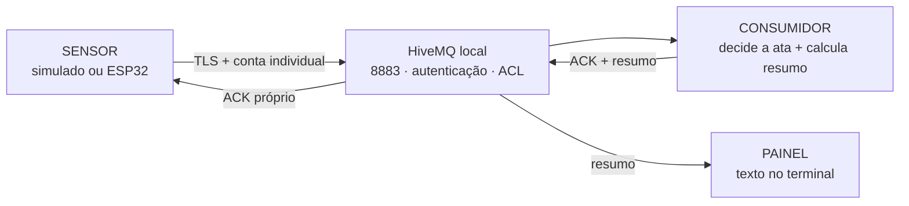

# Marco 3 — TowerAI: canal MQTT seguro e resumo da reunião

Este é o ponto de entrada para **rodar o marco 3**. A forma mais simples é abrir **`INICIAR-MARCO-3.cmd`**, na pasta principal do projeto, e escolher **2 — demonstração completa sem ESP32**.

O marco 3 funciona **no terminal**: um sensor simulado envia mensagens, o consumidor decide o estado da ata e o painel mostra o resultado. Você não precisa abrir uma página no navegador para acompanhar esta etapa. O painel aqui é uma saída de texto identificada como `[PAINEL]`.

## Primeira execução no Windows — comece aqui

1. Abra o **Docker Desktop** e aguarde ele terminar de iniciar. Use o modo de containers Linux.
2. No Explorador de Arquivos, abra a pasta **`pequi-ubiquo`**: é a pasta que contém este projeto, a subpasta `marco-3` e o arquivo **`INICIAR-MARCO-3.cmd`**.
3. Dê dois cliques em **`INICIAR-MARCO-3.cmd`**. Aparecerá o menu **“TowerAI — MARCO 3”**.
4. Digite **2** e pressione **Enter**. O iniciador prepara o necessário e executa uma demonstração narrada de aproximadamente 30 segundos.
5. Leia as linhas `[SENSOR]`, `[CONSUMIDOR]` e `[PAINEL]` no mesmo terminal. Ao terminar, o menu reaparece.

Requisitos instalados no PC: **Python 3.11+ no PATH** e **Docker Desktop com Compose**. Na primeira preparação, é necessário ter internet para baixar as dependências, a imagem HiveMQ e a extensão de segurança. O iniciador avisa quando estiver instalando algo. Nas próximas execuções, ele reutiliza o ambiente e os certificados existentes.

Você não precisa ativar `.venv`, copiar senhas nem abrir três terminais para esta demonstração. O comando usa os perfis locais de cada cliente e mantém as verificações TLS habilitadas.

### O que cada opção do menu faz

| Opção | Quando usar | O que acontece |
|---|---|---|
| **1. Preparar** | conferir a instalação antes da apresentação | prepara Python, certificados e contas se necessário, sobe o broker e valida TLS |
| **2. Demonstração sem ESP32** | primeira execução e apresentação do fluxo | faz a preparação necessária e mostra sensor + consumidor + painel no mesmo terminal |
| **3. Diagnosticar** | algo não está conectando | verifica dependências, Docker, arquivos, certificado e logins; não altera a configuração |
| **4. Acompanhar ESP32/Wokwi** | depois de configurar a placa ou o simulador | sobe o broker e acompanha consumidor + painel; aguarda mensagens do ESP32 |
| **5. Parar o broker** | terminar o uso do projeto | para o serviço local, preservando contas, certificados e dados |
| **0. Sair** | fechar o menu | fecha o iniciador; o broker continua como estava |

### Como saber se funcionou

| Momento da demonstração | O que observar |
|---|---|
| Preparação | `[OK] Broker local acessível em localhost:8883`, com certificado validado |
| Clientes conectados | `PRONTO` no consumidor e no painel |
| Começa a fala | `[PAINEL] Ata ABERTA` |
| O sensor repete uma mensagem | `[SENSOR] ... ACK duplicado`; a mesma ação não é aplicada duas vezes |
| Falha simulada do sensor | painel mostra `SUSPENSA` e alerta de falta de dados |
| Sensor volta | ata reabre; o consumidor volta a receber dados |
| Silêncio por 10 segundos | `[PAINEL] Resumo final`, com duração, fração de fala e qualidade |
| Fim | `Demonstração concluída` e retorno ao menu |

A qualidade pode ser `PARCIAL` ou `INCOMPLETA` porque o roteiro **simula uma falha de sensor de propósito**. Inicialmente o painel pode indicar estado desconhecido enquanto aguarda dados; isso é esperado. **Ata aberta significa decisão de negócio**: a gravação de áudio/transcrição no Flask ainda é uma evolução do projeto.

**Para interromper:** pressione **Ctrl+C** no terminal da execução. O iniciador encerra os clientes que abriu. O broker permanece disponível para a próxima rodada; use a opção **5** para pará-lo. Não é necessário apagar arquivos nem executar a geração de certificados novamente para repetir a demonstração.

## Se preferir digitar os comandos

No VS Code, abra a pasta **`pequi-ubiquo`** e selecione **Terminal → Novo Terminal**. O terminal deve estar na pasta principal, onde estão `README.md`, `INICIAR-MARCO-3.cmd` e `marco-3/`.

```powershell
# Abre o mesmo menu, sem depender de execução de scripts PowerShell
python marco-3/executar.py

# Executa a demonstração diretamente
python marco-3/executar.py demo

# Verifica o ambiente sem alterá-lo
python marco-3/executar.py diagnostico

# Prepara o ambiente sem iniciar sensor, consumidor ou painel
python marco-3/executar.py preparar

# Para apenas o broker, preservando a instalação
python marco-3/executar.py parar

# Acompanha mensagens do broker; Ctrl+C interrompe a leitura do log
python marco-3/executar.py logs
```

Esses mesmos comandos Python funcionam no Linux/macOS, com `python3` quando esse for o nome instalado. O iniciador localiza o projeto pelo próprio arquivo: se o terminal já estiver dentro de `marco-3`, use **`python executar.py demo`**. Não é necessário trocar a pasta para cada componente.

Os arquivos `run.ps1`, `run.sh` e `serve.py` da raiz iniciam a aplicação web TowerAI. **O comando desta etapa é `executar.py`, dentro de `marco-3`.**

## Se algo não funcionar

| Mensagem/situação | Como resolver |
|---|---|
| Python não encontrado | instale Python 3.11+ com a opção de adicioná-lo ao PATH; abra um novo terminal |
| Docker não encontrado | instale Docker Desktop e abra-o antes de executar o projeto |
| “Abra o Docker Desktop...” | aguarde o motor iniciar e confira o modo de containers Linux; tente novamente |
| Falha no download durante a primeira execução | verifique a internet e repita a opção 1; certificados existentes são preservados |
| Conta `mic-injetor` recusada | ela pode ter sido revogada após uma demo; siga o procedimento de reativação/rotação abaixo |
| Certificado inválido | confira endereço, relógio e CA no [guia do broker](broker/README.md); mantenha a validação TLS |
| Painel aguardando dados no modo ESP32 | confira se a placa/simulação está ligada, com broker local, Wi-Fi, credencial e NTP corretos |
| Só aparece erro ou a tela para de avançar | execute a opção 3; para detalhes do broker, use `python marco-3/executar.py logs` |

Se a conta de teste tiver sido revogada, sua reativação é uma ação explícita do administrador. Da raiz, use o Python do ambiente já preparado:

```powershell
.\.venv\Scripts\python.exe marco-3/broker/gerenciar_acesso.py mic-injetor --rotacionar
docker compose -f marco-3/broker/compose.yaml restart
```

No Linux/macOS, o executável correspondente é `.venv/bin/python`. Isso atualiza apenas a conta do injetor e preserva a CA. O iniciador nunca reativa uma conta revogada silenciosamente.

## O que está sendo executado

Continuação independente do [marco 2](../marco-2/README.md): sensor ESP32 ou injetor → broker local → consumidor → resumo → painel. O marco 2 e a aplicação Flask na raiz foram preservados.

**O broker é requisito de execução.** Usamos **HiveMQ Community Edition 2025.5**, instalado no PC com **File RBAC 4.6.15**. O iniciador o instancia em Docker, com TLS 1.2/1.3 na porta **8883**, CA da sala, credenciais individuais e autorização por tópico. O endereço padrão é `localhost:8883`, restrito ao próprio PC. Não há dependência de broker público durante a operação.



Para aprofundar: [plano de segurança](plano-seguranca.md), [instalação e operação do broker](broker/README.md), [contrato](contrato.md), [decisões](decisoes.md), [proposta de origem](proposta-seguranca-e-insights.md) e [evidências](evidencias/validacao.md).

## Estrutura e propósito

| Caminho | Responsabilidade |
|---|---|
| `broker/` | instalar e provisionar broker, certificados, contas e permissões |
| `mqtt_seguro.py` | configuração comum; TLS obrigatório, validação de CA/hostname e credenciais |
| `produtor/` | sensoriamento, fila, retry e ACK; agora com `WiFiClientSecure` e NTP local |
| `consumidor/sala.py` | validar identidade e contrato, deduplicar, ordenar e decidir ata |
| `consumidor/resumo.py` | calcular duração, fala, silêncio, lacunas e qualidade sem depender da rede |
| `consumidor/consumidor.py` | conectar regras ao MQTT, publicar ACK/resumo e registrar Last Will |
| `painel/painel.py` | assinante somente leitura; apresentar resumo e invalidar estado expirado |
| `ferramentas/` | injetar eventos, testar segurança/integração e compilar firmware |

## Preparação manual — para executar cada componente separadamente

Requisitos: Python **3.11+** (3.14 usado na validação), Docker Desktop com motor Linux ativo e Compose v2. Internet é necessária para instalar dependências e baixar a imagem/extensão; a comunicação entre componentes passa a ser inteiramente local. A biblioteca de provisionamento de certificados exige Python 3.11 ou superior.

```powershell
python -m venv .venv
.\.venv\Scripts\Activate.ps1
python -m pip install -r marco-3/requirements.txt
python marco-3/broker/preparar.py
docker compose -f marco-3/broker/compose.yaml up -d
docker compose -f marco-3/broker/compose.yaml logs --tail 40
```

Espere `Started TCP Listener with TLS` e a extensão RBAC iniciada. No Linux/macOS, ative com `source .venv/bin/activate`; os demais comandos são iguais. No Linux, a extensão precisa conseguir escrever seu histórico na pasta montada: veja [permissões do volume](broker/README.md#permissões-do-volume-no-linux).

`preparar.py` gera segredos em `broker/local/`, ignorado pelo Git, e recusa sobrescrever uma instalação existente. **Não o execute novamente para trocar só uma senha.** Cada `.env` contém apenas a conta daquele cliente; o arquivo é lido pela opção `--config`, sem executar comandos ou expandir variáveis. Variáveis `MQTT_*` do processo têm prioridade sobre o arquivo.

## Execução manual sem ESP32 — três terminais

Ative o mesmo ambiente virtual em cada terminal e execute da raiz:

```powershell
# Terminal 1: uma única fonte por sala; aqui, o injetor de teste
python marco-3/consumidor/consumidor.py --config marco-3/broker/local/consumidor-sala-204.env --dispositivo mic-injetor -v
```

```powershell
# Terminal 2: recebe apenas a informação derivada, sem acesso à telemetria
python marco-3/painel/painel.py --config marco-3/broker/local/painel-sala-204.env
```

```powershell
# Terminal 3: login próprio, limitado à subárvore dev/mic-injetor
python marco-3/ferramentas/injetar.py todos --config marco-3/broker/local/mic-injetor.env
```

O consumidor mostra eventos aplicados/duplicados/atrasados/rejeitados e publica ACK. O painel acompanha a decisão `ABERTA → ENCERRANDO → FECHADA` ou `SUSPENSA` quando falta dado. **“Ata ABERTA” indica decisão de negócio; não afirma que uma transcrição esteja sendo gravada.** A ponte para o Flask permanece evolução, como previsto na proposta.

## ESP32 físico e Wokwi

Comece pela demonstração sem placa para conferir a instalação. Para acompanhar a placa configurada, use a opção **4** do menu ou, da raiz:

```powershell
python marco-3/executar.py esp32
```

Esse modo inicia consumidor e painel e fica aguardando o **ESP32 real/simulado**. Não produz eventos por conta própria. Encerre com Ctrl+C. O firmware da placa ainda precisa ser provisionado conforme os passos abaixo.

1. Para hardware na LAN, inclua o IP real do PC no certificado **no primeiro provisionamento**, por exemplo `python marco-3/broker/preparar.py --ip 192.168.50.2`. Publique a porta na interface LAN conforme o guia do broker. `localhost` no ESP32 se refere à própria placa, não ao PC.
2. Copie `marco-3/broker/local/segredos.h` para `marco-3/produtor/segredos.h`. Ajuste Wi-Fi, `MQTT_BROKER` (nome/IP presente no SAN) e `NTP_SERVIDOR` (Raspberry Pi/PC com hora correta na rede local). O certificado da CA já está incluído. Este arquivo não deve ir ao Git.
3. Compile com Arduino CLI e core ESP32 **3.3.2**, biblioteca **PubSubClient 2.8** (comandos abaixo). Depois execute o consumidor sem `--dispositivo mic-injetor`, para usar `mic-esp32-01`.
4. Reaplique o roteiro de oito passos do marco 2: fala, retry, rede off, reconexão, consumidor off/retorno e falha do sensor. Os cenários em `produtor/testes/` foram reaproveitados; dependem de firmware e gateway locais configurados.

```powershell
arduino-cli core update-index --additional-urls https://espressif.github.io/arduino-esp32/package_esp32_index.json
arduino-cli core install esp32:esp32@3.3.2 --additional-urls https://espressif.github.io/arduino-esp32/package_esp32_index.json
arduino-cli lib install PubSubClient@2.8
python marco-3/ferramentas/compilar_produtor.py
python marco-3/consumidor/consumidor.py --config marco-3/broker/local/consumidor-sala-204.env
```

Para hardware na LAN, o iniciador também aceita `python marco-3/executar.py esp32 --broker 192.168.50.2`, usando o endereço efetivamente configurado no certificado e no bind do Docker. No primeiro provisionamento para essa rede, pode-se usar `python marco-3/executar.py preparar --ip 192.168.50.2 --broker 192.168.50.2`, depois de definir `MQTT_BIND_IP` conforme o guia do broker. `--ip` só é aplicado quando os certificados ainda não existem.

O compilador gera `produtor/build/sketch.ino.merged.bin` e `.elf`, usados por `wokwi.toml`. **Os binários antigos do marco 2 não foram reaproveitados:** não têm TLS e apontam para o broker público. Os novos binários contêm a senha provisionada e ficam fora do Git.

O Wokwi web com gateway público não alcança o broker deste PC. Use **Private IoT Gateway** (recurso pago no Wokwi web), habilite-o na simulação e configure `MQTT_BROKER` como `host.wokwi.internal`; esse nome já está no certificado. O Wokwi para VS Code inclui o gateway privado. Consulte as [instruções oficiais de rede](https://docs.wokwi.com/guides/esp32-wifi) e a [configuração no VS Code](https://docs.wokwi.com/vscode/project-config). O simulador/serviço de compilação pode exigir internet: a prova de operação offline completa deve ser feita com hardware real.

Sem gateway privado, a demonstração local com o injetor continua disponível. Não exponha o broker na internet para contornar essa limitação. O NTP da sala deve estar acessível também pelo gateway; sem horário válido o firmware aguarda e mantém os eventos na fila, sem desligar a validação TLS.

## Verificação

```powershell
# Regras e segurança da aplicação, sem broker
python -m unittest discover -s marco-3/consumidor -v
python -m unittest discover -s marco-3/painel -v

# Com o broker ativo e os clientes da demo parados
python marco-3/ferramentas/verificar_broker.py
python marco-3/ferramentas/testar_fluxo.py
```

O segundo teste inicia e encerra processos próprios; verifica ACK, deduplicação, resumo, retained, painel e Last Will real após queda abrupta. Não rode os testes de integração simultaneamente à demonstração: compartilham os tópicos da sala. [Evidências](evidencias/validacao.md) distinguem as verificações executadas dos testes de hardware/simulador.

## Limites desta etapa

Um microfone por sala; estado e deduplicação em RAM; nível de áudio simulado por potenciômetro; janelas por tempo de processamento no consumidor. TLS protege o enlace, mas o broker vê o conteúdo e precisa ser administrado como parte confiável da sala. Uma conta de dispositivo comprometida ainda pode mentir sobre seu próprio sensor. Limites de tráfego e quarentena automática no broker não estão implementados; há alerta de rejeições para ação do administrador. mTLS, assinatura do payload, persistência em SQLite e ponte para gravação no Flask ficam para evolução.
