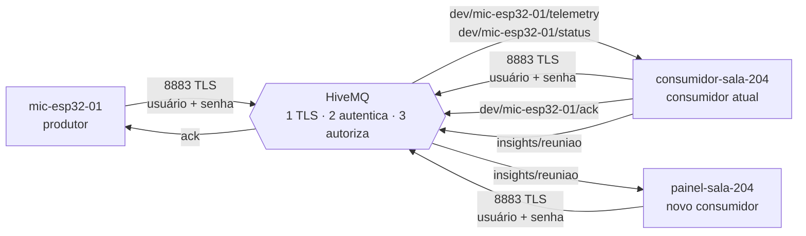

# Proposta: segurança do broker e informação derivada pelo consumidor

> **Implementação em 15/10/2026:** esta proposta foi usada como base do marco 3. O código executável está nas pastas desta etapa; [README](README.md), [plano de segurança](plano-seguranca.md) e [guia do broker local](broker/README.md) descrevem a implementação e seu aceite. Os trechos de código abaixo permanecem esboços de concepção; a fonte de verdade da execução são os arquivos `.py`/`.ino`. O painel apresenta a decisão da ata; gravação real no Flask continua evolução.

## Resumo

| | Proposta | Em uma frase |
|---|---|---|
| **1** | **Segurança** | O broker HiveMQ passa a exigir **usuário e senha por cliente, sobre TLS**, e a limitar cada cliente aos **seus próprios tópicos** (ACL). Quem publica e quem consome é identificado pelo broker. É recurso nativo do MQTT; não precisamos de outra tecnologia. |
| **2** | **Informação útil** | O consumidor publica um **resumo da reunião** (estado da ata, duração, tempo de fala, qualidade do dado) no tópico novo `…/sala-204/insights/reuniao`. Quem consome é um **novo consumidor, o `painel-sala`**, que avisa a sala "gravando a ata" e depois pode acionar o servidor Flask do TowerAI. |


# 1. Segurança: o broker valida quem publica e quem consome

## 1.1 Problemas que a segurança resolve

Qualquer pessoa que conheça o prefixo `ufg-ssu-2026/towerai` pode:

| # | Ataque | Efeito no sistema | Por que funciona hoje |
|---|---|---|---|
| A1 | Publicar um `audio.state.changed` falso com `state: "FALANDO"` | ata abre sem ninguém falando; ou `SILENCIO` e a ata fecha no meio da reunião | o consumidor confia no JSON; não sabe quem publicou |
| A2 | Publicar `status` com `offline` (retido) | ata fica `SUSPENSA`: negação de serviço | tópico de status aberto |
| A3 | **Publicar um ACK falso** em `ack/mic-esp32-01` | o ESP32 acredita que o estado foi entregue e **apaga o evento da fila**: perda de dado. O `eventId` é fácil de montar (`deviceId:bootId:sequence`, e o `bootId` aparece no tráfego público) | tópico de ACK aberto |
| A4 | Assinar `ufg-ssu-2026/towerai/#` | lê toda a telemetria, inclusive o estado de fala da sala (privacidade, o risco principal da Atividade 01) | leitura aberta |
| A5 | Enviar eventos inválidos em volume | o consumidor responde ACK de `rejeitado` para cada um, no tópico derivado do `deviceId` **do payload**; vira amplificação | `_ack()` usa o `deviceId` escrito pelo remetente |
| A6 | Usar o mesmo `deviceId` de outro dispositivo | passa a "ser" o microfone | a identidade é só um campo de texto |

## 1.2 Proposta: quatro camadas



| Camada | O que faz | Ataques que fecha |
|---|---|---|
| **1. TLS** (porta 8883) | cifra o tráfego e prova ao cliente que ele está falando com o broker certo | A4 (escuta no caminho), roubo de senha |
| **2. Autenticação** (usuário + senha por cliente) | o broker recusa conexão sem credencial válida. **Vale para quem publica e para quem consome**: o consumidor e o painel também fazem login | A1, A2, A3, A4 vindos de quem não tem conta |
| **3. Autorização** (ACL por tópico, negar por padrão) | cada cliente só publica e assina o que o seu papel permite. O dispositivo só escreve na **própria** subárvore | A1, A2, A3 vindos de quem **tem** conta (um dispositivo comprometido); A6 |
| **4. Identidade conferida no consumidor** | o consumidor compara o `deviceId` do payload com o do **tópico** (que o broker garantiu) e deriva o tópico do ACK do tópico, nunca do payload | A5, A6 |

## 1.3 Tópicos: contrato v1.1 (só os nomes mudam, o payload continua v1)

Hoje o tópico de telemetria **não contém o `deviceId`**, então o broker não consegue limitar "cada dispositivo escreve só no que é seu". Proposta: agrupar tudo de um dispositivo numa subárvore `dev/<deviceId>/`.

Prefixo: `ufg-ssu-2026/towerai/sala-204`

| Tópico | Publica | Assina | QoS | Retido |
|---|---|---|---|---|
| `…/dev/<deviceId>/telemetry` | o dispositivo | consumidor | 0 | não |
| `…/dev/<deviceId>/status` | o dispositivo (`online`) e o broker (Last Will `offline`) | consumidor | 1 | sim |
| `…/dev/<deviceId>/ack` | consumidor | o dispositivo | 1 | não |
| `…/insights/reuniao` (**novo, Parte 2**) | consumidor (e o Last Will dele) | `painel-sala`, Flask | 1 | sim |

Antes → depois: `telemetry/audio` vira `dev/mic-esp32-01/telemetry`; `status/mic-esp32-01` vira `dev/mic-esp32-01/status`; `ack/mic-esp32-01` vira `dev/mic-esp32-01/ack`. O `eventType` já distingue o tipo de dado, então o sufixo `/audio` deixa de ser necessário (e uma câmera futura entra como `dev/cam-esp32-03/telemetry`).

## 1.4 Identidades e permissões

Nome de usuário = `deviceId`/nome do serviço. Todos respeitam `^[A-Za-z0-9_-]{1,64}$`, a mesma regra `ID_VALIDO` que o `sala.py` já usa. Isso impede `+`, `#` e `/` no nome.

| Cliente (usuário) | Papel | Pode **publicar** | Pode **assinar** | Anônimo |
|---|---|---|---|---|
| `mic-esp32-01` | dispositivo | `dev/mic-esp32-01/telemetry`, `dev/mic-esp32-01/status` | `dev/mic-esp32-01/ack` | recusado |
| `consumidor-sala-204` | consumidor | `dev/+/ack`, `insights/reuniao` | `dev/+/telemetry`, `dev/+/status` | recusado |
| `painel-sala-204` | painel (somente leitura) | nada | `insights/reuniao` | recusado |
| *(qualquer outro)* | — | nada | nada | recusado |

Consequências diretas:
- só o `consumidor` consegue publicar em `insights/reuniao`: o painel confia no que lê lá;
- um dispositivo não consegue enviar ACK, nem escrever na área de outro, nem assinar `#`;
- o painel não vê telemetria nem identifica dispositivos.

## 1.5 Como configurar no HiveMQ

**Decisão confirmada:** o broker é **HiveMQ Community Edition instalado localmente**, com a File RBAC Extension. A combinação fixada para o laboratório é CE **2025.5**, Java 21 e File RBAC **4.6.15**, validada com TLS e autenticação no PC da sala. Não usamos HiveMQ Cloud nem o broker público do marco 2.

A instalação reproduzível está em [broker/README.md](broker/README.md). `broker/preparar.py` gera CA, certificado, keystore, senhas aleatórias, hashes e ACLs; `broker/compose.yaml` instancia o serviço. A pasta inteira de extensões é substituída, para não herdar o autenticador permissivo da imagem. Há somente listener TLS 8883, publicado em loopback por padrão; o guia explica como liberar a interface LAN.

Na File RBAC 4.6.15, os arquivos ficam em `conf/config.xml` e `conf/credentials.xml` dentro da extensão. `${{username}}` é a sintaxe de substituição de usuário. Foram acrescentados apenas a conta descartável `mic-injetor` para demonstração local e o procedimento de revogação/rotação. Os hashes usam o formato de três campos da versão fixada; exemplos legados não devem ser copiados indiscriminadamente.

**Semântica de revogação:** o reload só afeta novas conexões. É preciso desconectar a sessão antiga; no laboratório, reiniciar o broker. A compatibilidade e os caminhos foram conferidos na distribuição oficial e nos testes executados, substituindo as dúvidas presentes na proposta inicial.

## 1.6 Mudanças no código

### ESP32 (`sketch.ino`): TLS, credencial e novos tópicos

```cpp
#include <WiFiClientSecure.h>
#include "segredos.h"           // MQTT_USUARIO, MQTT_SENHA, CA_RAIZ  (fora do git)

const uint16_t MQTT_PORTA = 8883;
WiFiClientSecure rede;          // era WiFiClient
PubSubClient mqtt(rede);

// setup(): o TLS valida a data de validade do certificado, entao o relogio
// precisa estar certo antes de conectar (o projeto ja preve NTP local, Atividade 02)
configTime(0, 0, NTP_SERVIDOR);   // Raspberry Pi/PC da sala, configurado em segredos.h
rede.setCACert(CA_RAIZ);

snprintf(topicoEventos, sizeof topicoEventos, "%s/%s/dev/%s/telemetry", PREFIXO, ENTITY_ID, DEVICE_ID);
snprintf(topicoStatus,  sizeof topicoStatus,  "%s/%s/dev/%s/status",    PREFIXO, ENTITY_ID, DEVICE_ID);
snprintf(topicoAck,     sizeof topicoAck,     "%s/%s/dev/%s/ack",       PREFIXO, ENTITY_ID, DEVICE_ID);

// conectar(): so muda a chamada; o Last Will continua igual
if (!mqtt.connect(clientId, MQTT_USUARIO, MQTT_SENHA, topicoStatus, 1, true, will)) { ... }
```

- Só tentar conectar depois de o relógio estar sincronizado (`time(nullptr)` acima de uma data recente).
- No log de falha, `mqtt.state()` diz o motivo: `4` = credencial inválida, `5` = não autorizado.
- **Não usar `setInsecure()`**, que desliga a validação do certificado e anula a camada 1.

### Consumidor (`consumidor.py`): credencial por variável de ambiente

```python
ap.add_argument("--porta", type=int, default=8883)
usuario = os.environ["MQTT_USUARIO"]
senha = os.environ["MQTT_SENHA"]

client.username_pw_set(usuario, senha)
client.tls_set(ca_certs="ca-sala.pem")  # CA publica provisionada da sala; validar hostname

topico_eventos = f"{base}/dev/+/telemetry"
topico_status  = f"{base}/dev/+/status"
```

No `ao_receber`, o consumidor extrai o `deviceId` **do tópico** e passa à `Sala`:

```python
partes = msg.topic.split("/")          # [..., "dev", "<deviceId>", "telemetry"]
dispositivo = partes[-2]
res = sala.receber_evento(msg.payload, agora, dispositivo_do_topico=dispositivo)
...
if res.ack:                            # tópico do ACK vem do TOPICO, nao do payload
    client.publish(f"{base}/dev/{dispositivo}/ack", json.dumps(res.ack), qos=1)
```

### `sala.py`: identidade divergente vira rejeição

```python
def receber_evento(self, bruto, agora, dispositivo_do_topico=None):
    ...
    # depois da validacao de campos:
    if dispositivo_do_topico is not None and e["deviceId"] != dispositivo_do_topico:
        return self._rejeitar(f"identidade_divergente:{e['deviceId']}!={dispositivo_do_topico}")
        # sem "e": nao devolve ACK para um deviceId que o remetente inventou
```

`receber_status` ganha a mesma conferência. No `test_sala.py`, entram casos para a identidade divergente.

### `ferramentas/injetar.py`

Passa a ler `MQTT_USUARIO`/`MQTT_SENHA`, usar TLS e os tópicos novos, com credencial própria de teste (`injetor-teste`, papel `dispositivo`, descartada depois).

## 1.7 Segredos e ciclo de vida

| Tema | Regra |
|---|---|
| **Geração** | senha de 32 bytes aleatórios por cliente: `python -c "import secrets; print(secrets.token_urlsafe(32))"`. Mostrada uma vez ao administrador, como já fazemos em `devices.py` |
| **Armazenamento no ESP32** | `segredos.h` (no `.gitignore`), ou NVS. Nunca no `sketch.ino` versionado |
| **Armazenamento no PC** | variáveis de ambiente / `.env` (já existe `.env.example`; adicionar `MQTT_USUARIO` e `MQTT_SENHA`, sem valor) |
| **Wokwi** | o projeto é compartilhado por link, então qualquer credencial colocada nele fica visível. Usar uma **credencial descartável só para a demo**, com permissão mínima, e **revogá-la depois** |
| **Revogação** | apagar o usuário bloqueia novas conexões; encerrar também a sessão antiga (restart no laboratório). Dispositivo perdido ou suspeito: remover só ele, os outros continuam |
| **Rotação** | trocar a senha a cada semestre ou quando alguém sair do grupo |
| **Quarentena** | a regra da Atividade 02 (20 inválidos em 60 s ⇒ dispositivo em quarentena) passa a ter efeito real: o consumidor conta rejeições por tópico e o administrador revoga a credencial |

## 1.8 Como vamos provar que funciona

| # | Teste | Resultado esperado |
|---|---|---|
| T1 | conectar na porta 8883 **sem** usuário | conexão recusada |
| T2 | conectar com senha errada | recusada; ESP32 loga `state=4` |
| T3 | conectar na porta 1883 (sem TLS) | porta fechada no broker local |
| T4 | `mic-esp32-01` publicar em `dev/outro-dispositivo/telemetry` | negado pelo broker; o consumidor não recebe nada |
| T5 | `mic-esp32-01` assinar `…/#` ou `…/insights/reuniao` | negado |
| T6 | `painel-sala-204` publicar em qualquer tópico | negado |
| T7 | dispositivo ou painel autenticado publicar em `dev/mic-esp32-01/ack` (A3) | negado; a fila do ESP32 **não** é esvaziada |
| T8 | publicar, no tópico do `mic-esp32-01`, um payload com `deviceId` diferente | `REJEITADO identidade_divergente`, sem ACK |
| T9 | fluxo normal do Marco 2 (roteiro de 8 passos do README) | idêntico ao de hoje, agora sobre TLS com login |
| T10 | revogar a credencial do mic com ele conectado | ele não reconecta após a próxima queda |

Observação: no MQTT 3.1.1 o broker nem sempre devolve um erro para publicação não autorizada; pode descartar a mensagem ou derrubar a conexão, conforme a configuração. Os testes T4 a T7 devem observar o **efeito** (consumidor não recebe; fila do ESP32 intacta), não uma mensagem de erro.

## 1.9 O que a proposta ainda não resolve

- Um dispositivo **comprometido e autenticado** continua podendo mentir sobre os **próprios** dados (dizer `FALANDO` com a sala vazia). Isso é limite do sensor, e a Atividade 02 já trata parte disso cruzando áudio com presença por câmera.
- A senha dentro do firmware pode ser extraída com acesso físico à placa. Mitigação: uma senha por dispositivo (o estrago fica limitado a ele) e revogação.
- O broker é ponto único de confiança e roda localmente também na demonstração. Ele precisa receber manutenção, backup e controle administrativo.
- O conteúdo das mensagens passa em claro **dentro** do broker. Aqui só trafega estado e nível de áudio, não a voz.


# 2. Informação útil: resumo da reunião

## 2.1 Qual informação e por quê

**O problema.** No Marco 2 o consumidor decide a ata (`FECHADA → ABERTA → ENCERRANDO → SUSPENSA`), mas a decisão só aparece **no terminal dele**. A Atividade 02 define o objetivo do sistema como *"ligar a legenda ao vivo e gravar a ata automaticamente, sem ninguém apertar um botão"* e a etapa **ATUAR** como *"publica a legenda ao vivo, inicia/encerra a gravação da ata, avisa a sala"*. Nada disso acontece se ninguém além do consumidor sabe que a reunião começou. O `decisoes.md` também já prevê *"mais de um consumidor (legenda, ata, painel, app Android)"*.

**A informação.** Um **resumo da reunião** (`reuniao.resumo`), calculado só com o que o consumidor já recebe (estado do microfone, `audio.level`, heartbeat, Last Will):

| Campo | O que significa | Por que é útil |
|---|---|---|
| `ata` | `ABERTA`, `ENCERRANDO`, `SUSPENSA` ou `FECHADA` | quem reage (painel, Flask) não precisa reimplementar a regra |
| `sessaoId`, `iniciadaEm`, `duracaoS` | qual reunião é e há quanto tempo | título e carimbo da ata |
| `falaS`, `silencioS`, `taxaFala` | tempo de fala e de silêncio e a proporção | mede o quanto a reunião foi conversada |
| `atividade` | `BAIXA`, `MEDIA` ou `ALTA`, pela fala dos últimos 60 s | "janela deslizante de 60 s" da Atividade 02 |
| `pausas` | quantas vezes a reunião esfriou (`ENCERRANDO`) e voltou (`ABERTA`) | separa uma reunião contínua de uma com vários blocos |
| `nivelMedioDbfs`, `nivelPicoDbfs` | volume médio e máximo da fala | ajuda a regular o limiar de silêncio |
| `lacunaS`, `qualidade` | tempo sem dado confiável; `COMPLETA`, `PARCIAL` ou `INCOMPLETA` | **honestidade sobre a ata**: o sistema diz quando ela tem buracos, como a Atividade 02 faz com "presença não verificada" |
| `dispositivo` | microfone online? em que estado? | contexto para quem lê |
| `final` | `true` na última mensagem da sessão | marca o resumo definitivo |

Regras de cálculo (todas com o relógio do consumidor, como já fazem as janelas do `sala.py`):
- o intervalo entre duas chamadas é somado ao estado que valia **antes**: `FALANDO` com dispositivo online conta como fala; `SILENCIO` como silêncio; qualquer outra coisa (`FALHA_SENSOR`, `DESCONHECIDO`, offline) conta como **lacuna**, porque falta de dado não é silêncio (decisão do Vinícius, preservada);
- `atividade`: fala nos últimos 60 s `< 10 s` ⇒ `BAIXA` (10 s é o mínimo da Atividade 02 para abrir a reunião); `< 35 s` ⇒ `MEDIA`; senão `ALTA`. Os valores são parâmetros (`LIMIARES_ATIVIDADE_S`);
- `qualidade`: sem lacuna ⇒ `COMPLETA`; lacuna até 10 % ⇒ `PARCIAL`; mais que isso, ou ata fechada depois de 60 s `SUSPENSA` ⇒ `INCOMPLETA`.

## 2.2 Tópico, quem publica e quem consome

| | |
|---|---|
| **Novo tópico** | `ufg-ssu-2026/towerai/sala-204/insights/reuniao` |
| **Publica** | `consumidor-sala-204` (o consumidor atual, depois que a `Sala` decide) |
| **Novo consumidor** | **`painel-sala`** (`painel-sala-204`), processo separado, **somente leitura** |
| **QoS / retido** | QoS 1, **retido**: quem conecta depois recebe logo o último resumo |

## 2.3 O consumidor novo: `painel-sala`

Papel: **ATUAR** na sala, a etapa que hoje não existe. Assina só `insights/reuniao` e reage:

| Mensagem recebida | O painel faz |
|---|---|
| `ata: ABERTA` (primeira da sessão) | exibe **"● Gravando a ata"** (no terminal; em evolução, um LED vermelho num segundo ESP32 no Wokwi) |
| `ata: ENCERRANDO` | "Reunião em pausa; encerra em instantes" |
| `ata: SUSPENSA` ou `qualidade: PARCIAL/INCOMPLETA` | "Atenção: sem dado do microfone, a ata pode ficar incompleta" |
| `final: true` | mostra o resumo final: duração, % de fala, qualidade |
| mensagem **velha** (`geradoEm` há mais de 90 s com a ata não `FECHADA`) ou `motivo: consumidor_offline` | mostra **"estado desconhecido"**; nunca fica congelado em "gravando" (mesma regra "dado que expira vira DESCONHECIDO" do Moisés) |

**Evolução (não obrigatória no Marco):** o mesmo tópico alimenta a **ponte para o Flask** do TowerAI. Ao receber `ata: ABERTA`, ela chama o que `features/meetings.py` já tem (`db.start_meeting(room, title, created_by)`, com o `sessaoId` no título), e ao receber `final: true` chama `db.stop_meeting`. Isso fecha o ciclo da Atividade 02: a reunião passa a abrir e fechar sem botão. Como é só mais um assinante, não exige mudar o consumidor.

## 2.4 Quando o consumidor publica

| Gatilho | `motivo` | `final` |
|---|---|---|
| a ata **muda de estado** | `transicao` | `true` só ao entrar em `FECHADA` |
| a cada **30 s** enquanto a ata não está `FECHADA` | `periodico` | `false` |
| o consumidor cai sem avisar | `consumidor_offline` (**Last Will** dele, retido) | `false` |

Publicar só em transição e a cada 30 s evita inundar o broker (a regra "atuar só em transição" do Thiago). O Last Will do consumidor usa o mesmo mecanismo que o ESP32 já usa, no mesmo tópico, então o painel não precisa de um tópico a mais para saber que o consumidor caiu:

```python
client.will_set(topico_insights, json.dumps({
    "schemaVersion": 1, "insightType": "reuniao.resumo", "entityId": args.sala,
    "motivo": "consumidor_offline", "ata": "DESCONHECIDO", "final": False,
}), qos=1, retain=True)
```

## 2.5 Exemplo de mensagem

Gerado pelo esboço de `resumo.py` (seção 2.6) numa simulação com 71 s de fala seguidos de silêncio:

```json
{
  "schemaVersion": 1,
  "insightType": "reuniao.resumo",
  "insightId": "sala-204-20261012-193002:5",
  "entityId": "sala-204",
  "sessaoId": "sala-204-20261012-193002",
  "geradoEm": "2026-10-12T19:31:23-03:00",
  "motivo": "transicao",
  "final": true,
  "ata": "FECHADA",
  "iniciadaEm": "2026-10-12T19:30:02-03:00",
  "duracaoS": 81,
  "falaS": 71,
  "silencioS": 10,
  "lacunaS": 0,
  "taxaFala": 0.88,
  "pausas": 0,
  "nivelMedioDbfs": -22.0,
  "nivelPicoDbfs": -20,
  "atividade": "ALTA",
  "qualidade": "COMPLETA",
  "dispositivo": { "online": true, "microfone": "SILENCIO" },
  "avisos": []
}
```

Uma mensagem de uma reunião com falha do sensor ficaria com `"qualidade": "INCOMPLETA"` e `"avisos": ["sem_dado_confiavel_60s"]`.

Versionamento: igual ao do contrato (campo novo opcional continua `schemaVersion: 1`; o painel ignora campos que não conhece e rejeita versão desconhecida).

## 2.6 Mudanças no código

**Novo arquivo `consumidor/resumo.py`** (lógica pura, sem rede, testável como o `sala.py`). Este esboço foi executado contra o `sala.py` do projeto em dois cenários: reunião normal (ata abre, fecha, resumo final com 88 % de fala e `COMPLETA`) e queda do microfone (ata `SUSPENSA` e depois `FECHADA` com `INCOMPLETA`).

<details>
<summary>Código do esboço de <code>resumo.py</code></summary>

```python
"""Resumo da reuniao: transforma o que a Sala decidiu em informacao publicavel.

Logica pura, sem rede (como sala.py). O consumidor chama avancar() depois de
cada mensagem e a cada tick de 1 s, e publica o que ela devolver.
"""
from collections import deque

SCHEMA_VERSION = 1
JANELA_ATIVIDADE_S = 60.0      # mesma janela deslizante da Atividade 02
LIMIARES_ATIVIDADE_S = (10.0, 35.0)   # fala na janela: < 10 BAIXA, < 35 MEDIA, senao ALTA
PERIODO_PUBLICACAO_S = 30.0    # reenvio periodico enquanto a ata nao esta FECHADA
LACUNA_PARCIAL = 0.10          # ate 10 % da sessao sem dado confiavel = PARCIAL


class Resumo:
    def __init__(self, sala_id):
        self.sala_id = sala_id
        self._t = None             # relogio do consumidor na ultima chamada
        self._cat = "lacuna"       # categoria do intervalo que acabou de passar
        self._ata = "FECHADA"
        self._rev = 0
        self._ultima_pub = None
        self._forcar_incompleta = False
        self.sessao = None
        self._zerar()

    def _zerar(self):
        self.iniciada_em = None
        self.fala_s = self.silencio_s = self.lacuna_s = 0.0
        self.pausas = 0
        self._niveis = [0.0, 0]    # soma, quantidade
        self.pico = None
        self._janela = deque()     # (instante, segundos de fala)
        self._forcar_incompleta = False

    def registrar_nivel(self, dbfs):
        """audio.level aplicado: so existe enquanto o microfone esta FALANDO."""
        self._niveis[0] += dbfs
        self._niveis[1] += 1
        self.pico = dbfs if self.pico is None else max(self.pico, dbfs)

    def avancar(self, sala, agora, agora_dt):
        """Devolve a lista de resumos a publicar (normalmente 0 ou 1)."""
        dt = 0.0 if self._t is None else agora - self._t
        self._t = agora

        # 1. o intervalo que passou pertence ao estado anterior
        if self._ata != "FECHADA" and dt > 0:
            if self._cat == "fala":
                self.fala_s += dt
                self._janela.append((agora, dt))
            elif self._cat == "silencio":
                self.silencio_s += dt
            else:
                self.lacuna_s += dt
        while self._janela and self._janela[0][0] < agora - JANELA_ATIVIDADE_S:
            self._janela.popleft()

        # 2. a ata mudou?
        saidas = []
        if sala.ata != self._ata:
            antes, self._ata = self._ata, sala.ata
            if antes == "FECHADA":
                self._zerar()
                self.sessao = f"{self.sala_id}-{agora_dt:%Y%m%d-%H%M%S}"
                self.iniciada_em = agora_dt.isoformat(timespec="seconds")
                self._rev = 0
            if antes == "ENCERRANDO" and sala.ata == "ABERTA":
                self.pausas += 1
            if antes == "SUSPENSA" and sala.ata == "FECHADA":
                self._forcar_incompleta = True
            saidas.append(self._montar(sala, agora_dt, "transicao", sala.ata == "FECHADA"))
            self._ultima_pub = agora
        elif self._ata != "FECHADA" and agora - self._ultima_pub >= PERIODO_PUBLICACAO_S:
            saidas.append(self._montar(sala, agora_dt, "periodico", False))
            self._ultima_pub = agora

        # 3. categoria do proximo intervalo
        if sala.online and sala.mic == "FALANDO":
            self._cat = "fala"
        elif sala.online and sala.mic == "SILENCIO":
            self._cat = "silencio"
        else:
            self._cat = "lacuna"
        return saidas

    def _atividade(self):
        fala = sum(s for _, s in self._janela)
        baixo, alto = LIMIARES_ATIVIDADE_S
        return "BAIXA" if fala < baixo else "MEDIA" if fala < alto else "ALTA"

    def _qualidade(self, duracao):
        if self._forcar_incompleta:
            return "INCOMPLETA"
        frac = self.lacuna_s / duracao if duracao else 0.0
        if self.lacuna_s < 1:
            return "COMPLETA"
        return "PARCIAL" if frac <= LACUNA_PARCIAL else "INCOMPLETA"

    def _montar(self, sala, agora_dt, motivo, final):
        self._rev += 1
        duracao = self.fala_s + self.silencio_s + self.lacuna_s
        observado = self.fala_s + self.silencio_s
        soma, n = self._niveis
        avisos = []
        if self.lacuna_s >= 1:
            avisos.append(f"sem_dado_confiavel_{self.lacuna_s:.0f}s")
        return {
            "schemaVersion": SCHEMA_VERSION,
            "insightType": "reuniao.resumo",
            "insightId": f"{self.sessao}:{self._rev}",
            "entityId": self.sala_id,
            "sessaoId": self.sessao,
            "geradoEm": agora_dt.isoformat(timespec="seconds"),
            "motivo": motivo,
            "final": final,
            "ata": sala.ata,
            "iniciadaEm": self.iniciada_em,
            "duracaoS": round(duracao),
            "falaS": round(self.fala_s),
            "silencioS": round(self.silencio_s),
            "lacunaS": round(self.lacuna_s),
            "taxaFala": round(self.fala_s / observado, 2) if observado else None,
            "pausas": self.pausas,
            "nivelMedioDbfs": round(soma / n, 1) if n else None,
            "nivelPicoDbfs": self.pico,
            "atividade": self._atividade(),
            "qualidade": self._qualidade(duracao),
            "dispositivo": {"online": sala.online, "microfone": sala.mic},
            "avisos": avisos,
        }
```

</details>

**`consumidor.py`:** liga o resumo ao MQTT (poucas linhas, a regra continua fora do código de rede):

```python
from datetime import datetime
from resumo import Resumo

resumo = Resumo(args.sala)
topico_insights = f"{base}/insights/reuniao"

def publicar_resumos(client, agora):
    for r in resumo.avancar(sala, agora, datetime.now().astimezone()):
        client.publish(topico_insights, json.dumps(r), qos=1, retain=True)

# em ao_receber(), depois de sala.receber_evento(...):
#     if res.evento and res.evento.get("eventType") == "audio.level" and res.status == "TELEMETRIA":
#         resumo.registrar_nivel(res.evento["value"])
#     publicar_resumos(client, agora)
# e no laco de 1 s, depois de sala.tick(...):
#     publicar_resumos(client, time.monotonic())
```

**Novo `painel/painel.py`:** cliente MQTT de ~60 linhas: `username_pw_set` + `tls_set`, assina `insights/reuniao`, aplica a tabela da seção 2.3 e imprime o estado.

**`contrato.md`:** nova seção "Tópico de saída `insights/reuniao`" com o payload da seção 2.5.


## 2.7 Como vamos provar que funciona

| # | Teste | Resultado esperado |
|---|---|---|
| R1 | `test_resumo.py`: sequência FALANDO → SILENCIO → 10 s | ata `FECHADA`, `final: true`, `falaS` e `silencioS` coerentes |
| R2 | queda do dispositivo (Last Will) por 60 s | `qualidade: INCOMPLETA`, aviso `sem_dado_confiavel_*` |
| R3 | `ENCERRANDO → ABERTA` | `pausas` aumenta em 1 |
| R4 | 30 s com a ata `ABERTA` | uma mensagem `periodico` |
| R5 | consumidor derrubado com `Ctrl+C` abrupto | painel recebe `consumidor_offline` e mostra "desconhecido" |
| R6 | painel iniciado **depois** da reunião | recebe na hora o último resumo (retido) |
| R7 | `painel-sala-204` tenta publicar em `insights/reuniao` | negado (Proposta 1) |
| R8 | roteiro de 8 passos do README, com o painel ligado | o painel acompanha cada transição da ata |

## 2.8 Limitações

- Os tempos usam o relógio do consumidor (`time.monotonic()`), como as janelas atuais do `sala.py`; o `eventTimeMs` do ESP32 continua sendo `millis()` desde o boot, não hora real.
- O estado da sessão fica na RAM do consumidor: se ele reiniciar no meio da reunião, a sessão recomeça (mesma limitação já declarada para a deduplicação). Persistir no SQLite fica para a integração com o Flask.
- Com um microfone só, `taxaFala` mede **atividade de som**, não quantas pessoas falaram nem quem falou. Isso depende de STT e visão (outro fluxo, Atividades 01 e 02).
- O potenciômetro continua simulando o microfone; os valores em dBFS são fictícios.

---

# Como as duas propostas se encaixam

## Contas e permissões, juntas

| Cliente | Proposta 1 (identidade) | Proposta 2 (papel no resumo) |
|---|---|---|
| `mic-esp32-01` | publica só em `dev/mic-esp32-01/*`, assina só o próprio `ack` | não participa |
| `consumidor-sala-204` | lê todos os `dev/+/telemetry` e `status`, responde `ack` | **publica** `insights/reuniao` (e o Last Will dele) |
| `painel-sala-204` | só leitura | **assina** `insights/reuniao` e aciona a sala |

## Roteiro sugerido

| Fase | Vinícius (broker e firmware) | Thiago (consumidor, resumo e painel) | Depende de |
|---|---|---|---|
| **1. Base** | HiveMQ local (Docker) com **TLS na 8883** e porta 1883 fechada; File RBAC com 3 usuários (`mic-esp32-01`, `consumidor-sala-204`, `painel-sala-204`) e as permissões da seção 1.5; testes **T1, T2, T3** | `Sala` com checagem de identidade (`dispositivo_do_topico`) + testes em `test_sala.py`; `resumo.py` + `test_resumo.py` (lógica pura, **sem broker**); testes **R1 a R4** | — (cada um trabalha sozinho) |
| **2. Integração** | `sketch.ino`: `WiFiClientSecure`, sincronização de relógio, usuário/senha em `segredos.h`, tópicos `dev/<deviceId>/…`; atualizar `injetar.py` (TLS, credencial, tópicos novos); testes **T4 a T7** | `consumidor.py`: TLS, credencial por variável de ambiente, tópicos `dev/+/…`, ACK derivado do tópico, publicação em `insights/reuniao` (QoS 1, retido) e Last Will; `painel/painel.py`; testes **T8, R5, R6** | Fase 1 |
| **3. Fechamento** | revogação de credencial (**T10**); documentar a subida do broker e a geração das senhas no README | rodar o roteiro de 8 passos do README com o painel ligado (**T9, R8**); atualizar `contrato.md` (tópicos v1.1 e `insights/reuniao`); **R7** junto com o Vinícius | Fase 2 |
| **Evolução** | mTLS por dispositivo; HMAC no payload | ponte painel → Flask (`start_meeting`/`stop_meeting`); calibração do limiar (2.7) | Fase 3 |

Na Fase 1 os dois trabalham em paralelo, porque a lógica do Thiago não depende do broker. Na Fase 2 o Thiago só testa de ponta a ponta quando as credenciais do Vinícius estiverem prontas.


## Fontes da proposta original

- HiveMQ, [File RBAC Extension](https://www.hivemq.com/extension/file-rbac-extension/) e [repositório no GitHub](https://github.com/hivemq/hivemq-file-rbac-extension): usuários, papéis e permissões por XML, senhas com hash, substituição de usuário e client ID nos tópicos.
- HiveMQ, [Access Management Options per Cloud Subscription Plan](https://docs.hivemq.com/hivemq-platform/connect/access-management-options-per-cloud-plan.html): o que cada plano do HiveMQ Cloud oferece (no Serverless: usuário e senha, uma permissão por credencial, sem RBAC e sem variáveis de tópico).
- HiveMQ, [Add a Permission](https://docs.hivemq.com/hivemq-platform/connect/add-a-permission.html): criação de permissões com filtro de tópico e tipo; mudanças levam alguns minutos para valer.
- HiveMQ Community, [How to create user and password for HiveMQ Community Edition](https://community.hivemq.com/t/how-to-create-user-and-password-for-hivemq-community-edition/2962): recomendação da File RBAC Extension para a Community Edition (sem confirmação explícita de compatibilidade).
- Documentos do projeto: `marco-2/contrato.md`, `marco-2/decisoes.md`, `marco-2/README.md`, `atividade-02.md`, e o código de `consumidor.py`, `sala.py`, `sketch.ino`, `devices.py`.


# Direitos do documento

Eu, Moisés Ferreira Protázio Bastos, utilizei o auxílio do Claude para gerar esse documento sob minhas instruções. Com o documento pronto, eu revisei ele por completo, tomei decisões e removi partes que eu achei que não eram pertinentes ou que eu não queria que entrasse na proposta para o marco 3.