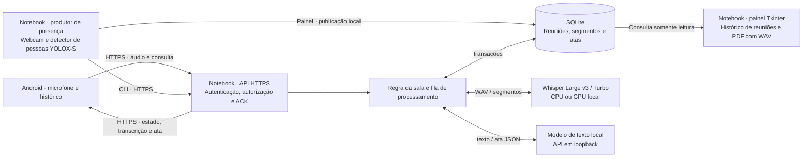

# Arquitetura

O notebook executa a API, a política de decisão, o processamento e a persistência. O Android capta PCM, confirma a entrega e mostra o estado calculado. Em linha de comando, o produtor visual usa credencial própria para enviar a contagem e o horário via HTTPS. No painel, a webcam publica a observação localmente com uma identidade interna da sala. O modelo de texto aceita conexões de loopback. A aba **Histórico** lê o SQLite local e exporta os detalhes da reunião, com o áudio salvo em anexo quando disponível, mesmo com a API parada.

[Versão editável em Draw.io](arquitetura.drawio)
