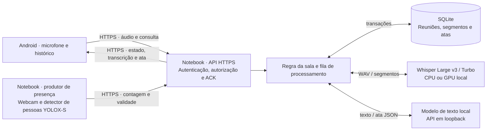

# Arquitetura

O notebook executa a API, o processamento e a persistência. A autorização está na API e usa uma identidade por produtor. O Android capta PCM, confirma a entrega e mostra o estado calculado. O produtor visual usa um processo próprio e envia apenas a estimativa. O modelo de texto aceita conexões de loopback, pois a API é sua única cliente.

[Versão editável em Draw.io](arquitetura.drawio)
